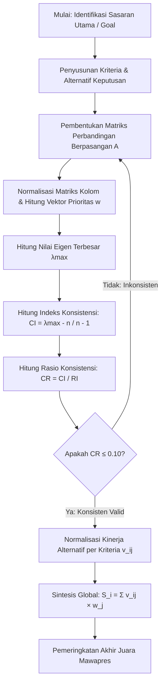
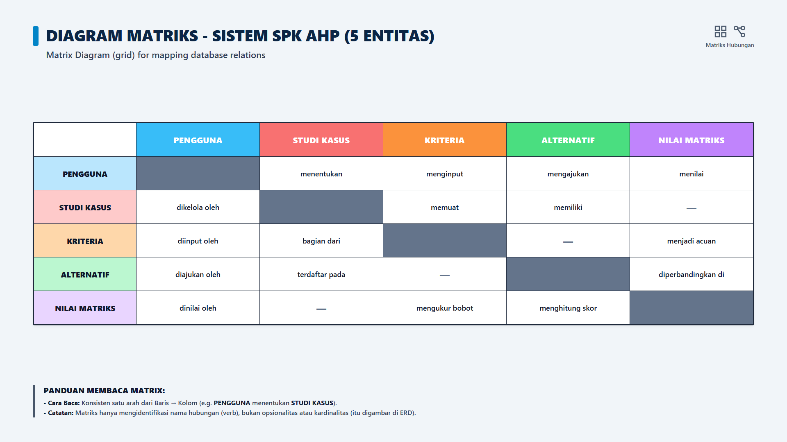
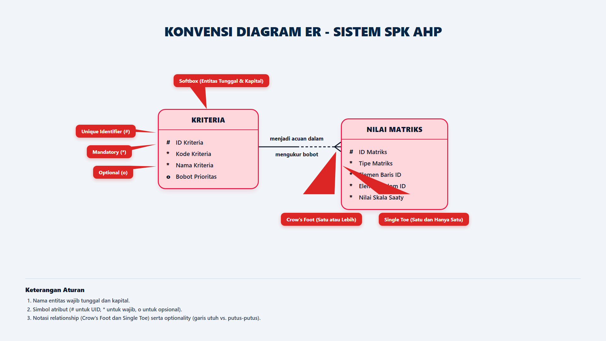
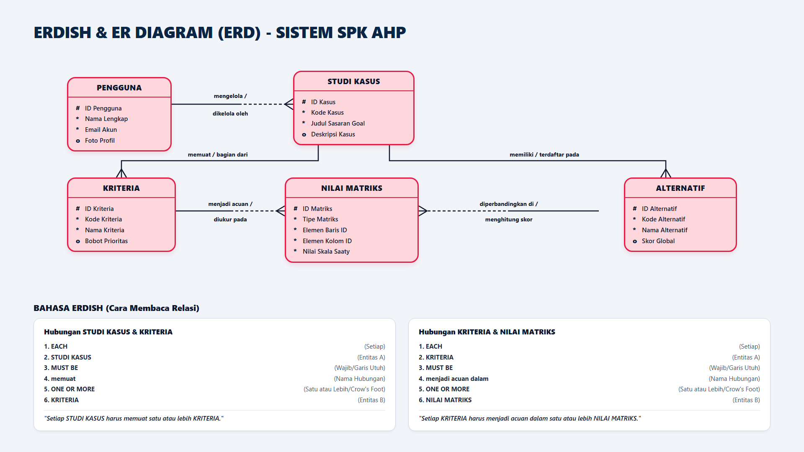
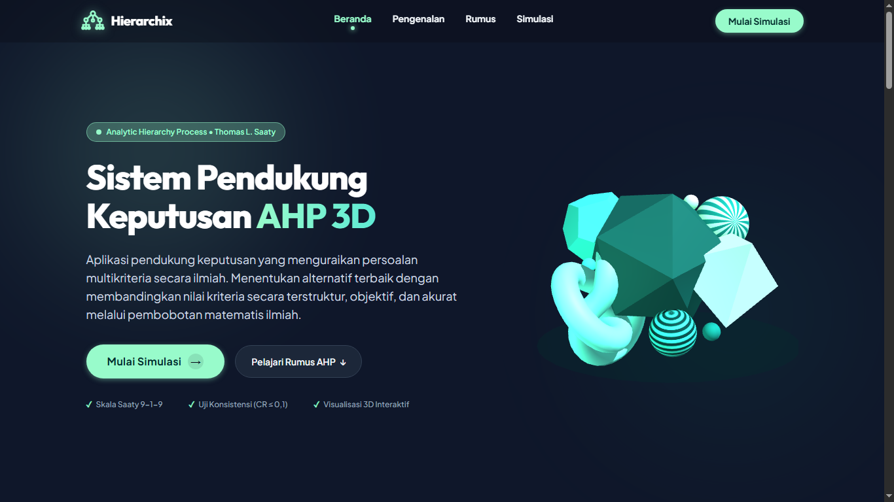
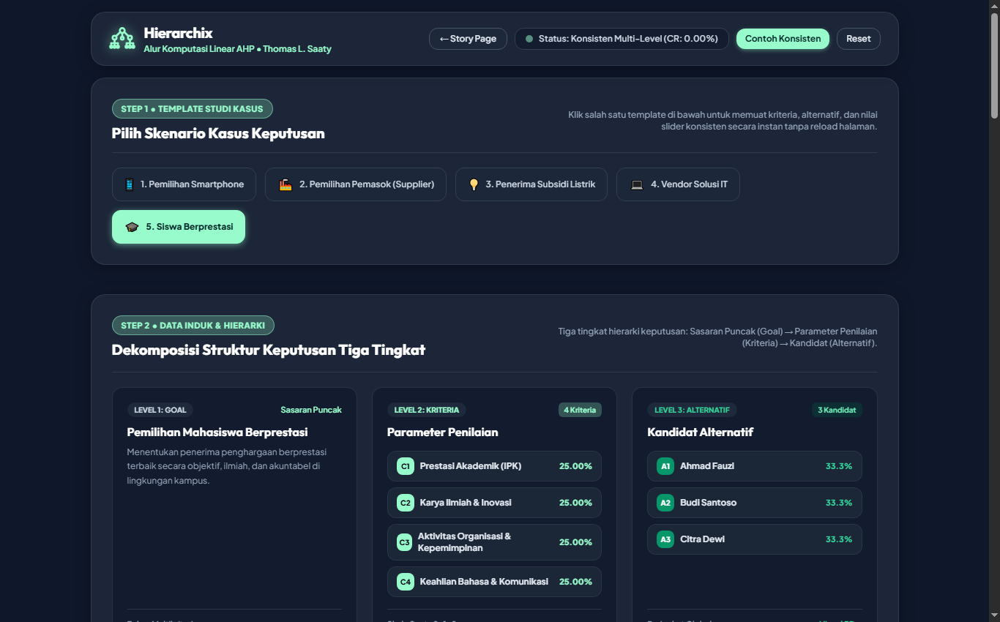
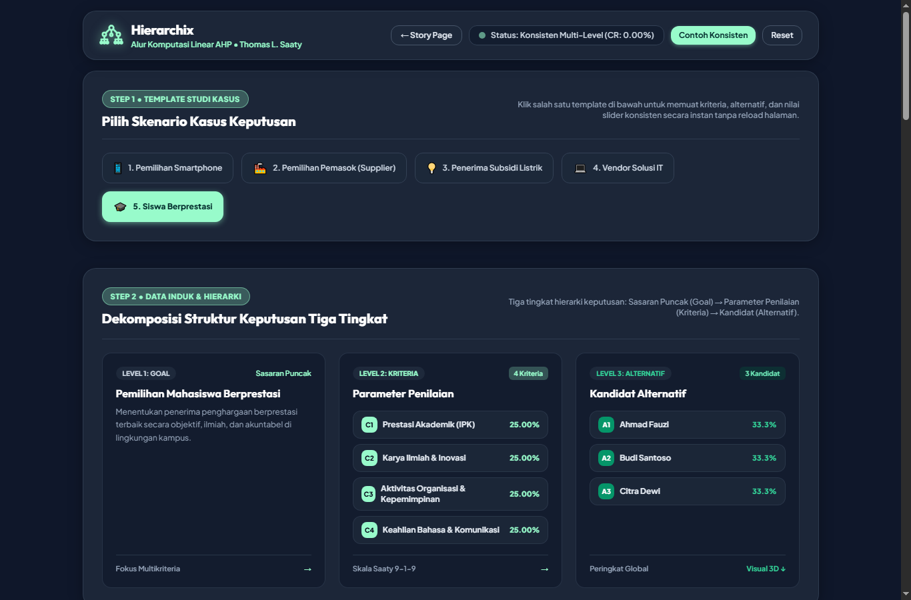

<div align="center">

# 🏛️ HIERARCHIX
### Sistem Pendukung Keputusan (SPK) Berbasis *Analytic Hierarchy Process* (AHP) & Visualisasi 3D WebGL

[](https://hierarchix.pages.dev/)
[](https://spk-ahp-frontend.pages.dev/)
[](https://laravel.com/)
[](https://www.php.net/)
[](https://threejs.org/)
[](https://tailwindcss.com/)

<p align="center">
  <b>Platform simulasi komputasi multikriteria modern, objektif, dan terverifikasi secara matematis untuk pemilihan Mahasiswa Berprestasi (Mawapres) dengan visualisasi 3 dimensi interaktif bertenaga Three.js WebGL.</b>
</p>

[🌐 Kunjungi Website (Hierarchix)](https://hierarchix.pages.dev/) • [📊 Coba Simulator AHP](https://hierarchix.pages.dev/ahp/) • [📖 Dokumentasi Matematis](#-metodologi-komputasi-ahp--formulasi-matematis) • [📐 Skema Database & ERD](#-desain-basis-data--erd-entity-relationship-diagram)

---

</div>

## 📌 Daftar Isi
- [Ringkasan Proyek](#-ringkasan-proyek)
- [Fitur Utama & Keunggulan](#-fitur-utama--keunggulan)
- [Metodologi Komputasi AHP & Formulasi Matematis](#-metodologi-komputasi-ahp--formulasi-matematis)
- [Studi Kasus: Pemilihan Mahasiswa Berprestasi (7 Alternatif)](#-studi-kasus-pemilihan-mahasiswa-berprestasi-7-alternatif)
- [Desain Basis Data & ERD (Entity Relationship Diagram)](#-desain-basis-data--erd-entity-relationship-diagram)
- [Galeri Antarmuka Sistem (Dokumentasi Visual)](#-galeri-antarmuka-sistem-dokumentasi-visual)
- [Teknologi yang Digunakan (Tech Stack)](#-teknologi-yang-digunakan-tech-stack)
- [Panduan Instalasi & Menjalankan Proyek Lokal](#-panduan-instalasi--menjalankan-proyek-lokal)
- [Arsitektur Deployment Cloudflare Pages](#-arsitektur-deployment-cloudflare-pages)
- [Struktur Direktori Repositori](#-struktur-direktori-repositori)
- [Lisensi & Penulis](#-lisensi--penulis)

---

## 💡 Ringkasan Proyek

**Hierarchix** adalah sistem pendukung keputusan (*Decision Support System*) berbasis web yang mengimplementasikan algoritma **Analytic Hierarchy Process (AHP)** yang dirumuskan oleh Prof. Thomas L. Saaty. Sistem ini dikembangkan untuk memecahkan permasalahan pengambilan keputusan multikriteria kompleks pada pemilihan **Mahasiswa Berprestasi (Mawapres)** tingkat universitas secara objektif, ilmiah, dan transparan.

Kelemahan utama metode konvensional/manual dalam seleksi mahasiswa berprestasi adalah tingginya risiko subjektivitas juri, ketidakmampuan menakar trade-off antarkriteria yang berbeda dimensi (misal: IPK vs karya ilmiah), dan tidak adanya mekanisme validasi konsistensi penilaian. Hierarchix menjawab tantangan tersebut dengan:
1. Mendekomposisi permasalahan ke dalam hierarki keputusan tiga tingkat (*Goal $\rightarrow$ Criteria $\rightarrow$ Alternatives*).
2. Menghitung pembobotan prioritas (*Eigen Vector*) secara presisi.
3. Menguji rasio konsistensi (*Consistency Ratio / CR*) dengan ambang batas toleransi $CR \le 10\%$.
4. Menyajikan output pemeringkatan akhir dalam format tabel interaktif dan grafik batang 3 dimensi (*Three.js WebGL*).

---

## ✨ Fitur Utama & Keunggulan

| Fitur | Deskripsi |
| :--- | :--- |
| ⚡ **Dual-Engine Architecture** | Komputasi AHP hybrid: Backend PHP Laravel 12 (`AhpController.php`) untuk pemrosesan API dan Client-Side Reactive Engine (Vanilla JS) untuk kalkulasi realtime tanpa jeda jaringan. |
| 🎛️ **Interactive Saaty 9-1-9 Sliders** | Antarmuka perbandingan berpasangan interaktif dengan skala Saaty 1–9 resiprokal otomatis ($a_{ji} = 1 / a_{ij}$) disertai badge status verbal dinamis. |
| 🛡️ **Live Multi-Level Consistency Badge** | Pemantauan rasio konsistensi secara langsung (*real-time*). Sistem memberikan peringatan visual instan jika pertimbangan matriks inkonsisten ($CR > 0.10$). |
| 🧊 **3D WebGL Decision Bar Chart** | Visualisasi grafis batang 3 dimensi bertenaga Three.js dengan rotasi mouse 360°, orbit control, efek pencahayaan studio, dan palet warna prosedural. |
| 👥 **Dynamic Candidate Input** | Kemampuan menambahkan alternatif kandidat secara dinamis tanpa batas jumlah, dengan auto-recalculation pada seluruh matriks hierarki. |
| 📱 **Full Responsive Layout (9:16 Mobile to Desktop)** | Antarmuka adaptif yang dioptimalkan untuk perangkat seluler rasio 9:16, tablet, hingga layar desktop ultra-wide tanpa kebocoran scroll horizontal. |
| ☁️ **Edge Deployment Ready** | Arsitektur frontend terdistribusi secara global melalui jaringan CDN Cloudflare Pages dengan latensi mendekati nol. |

---

## 📐 Metodologi Komputasi AHP & Formulasi Matematis

Algoritma komputasi AHP pada Hierarchix mengikuti kaidah baku Thomas L. Saaty (1980):



### 1. Skala Fundamental Thomas L. Saaty (1 – 9)
| Nilai Intensitas | Definisi Penilaian | Penjelasan Komparasi |
| :---: | :--- | :--- |
| **1** | Sama penting (*Equal Importance*) | Kedua elemen menyumbang pengaruh seimbang |
| **3** | Sedikit lebih penting (*Moderate Importance*) | Pengalaman/pertimbangan sedikit memihak satu elemen |
| **5** | Lebih penting (*Strong Importance*) | Pertimbangan sangat memihak satu elemen dibanding lainnya |
| **7** | Sangat penting (*Very Strong Importance*) | Satu elemen terbukti dominan secara signifikan |
| **9** | Mutlak sangat penting (*Extreme Importance*) | Tingkat penegasan tertinggi keunggulan satu elemen |
| **2, 4, 6, 8** | Nilai antara (*Intermediate Values*) | Diberikan jika diperlukan kompromi antar pertimbangan |
| **Resiprokal ($1/x$)** | Nilai kebalikan (*Reciprocal*) | Jika $a_{ij} = k$, maka $a_{ji} = 1/k$ |

### 2. Normalisasi Matriks & Bobot Prioritas ($w$)
Setiap elemen matriks dinormalisasi dengan membagi nilainya terhadap jumlah total kolom:
$$r_{ij} = \frac{a_{ij}}{\sum_{k=1}^n a_{kj}}$$
Vektor prioritas (*Priority Vector / w*) dihitung dengan merata-ratakan nilai baris hasil normalisasi:
$$w_i = \frac{1}{n} \sum_{j=1}^n r_{ij}$$

### 3. Pengujian Rasio Konsistensi (Consistency Ratio / CR)
Nilai eigen terbesar ($\lambda_{max}$) dihitung dari perkalian total kolom matriks mula-mula dengan bobot prioritas:
$$\lambda_{max} = \sum_{j=1}^n \left( \sum_{i=1}^n a_{ij} \times w_j \right)$$
Indeks Konsistensi (*Consistency Index / CI*):
$$CI = \frac{\lambda_{max} - n}{n - 1}$$
Rasio Konsistensi (*Consistency Ratio / CR*):
$$CR = \frac{CI}{RI}$$

**Tabel Random Index ($RI$) Saaty:**
| $n$ | 1 | 2 | 3 | 4 | 5 | 6 | 7 | 8 | 9 | 10 |
| :---: | :---: | :---: | :---: | :---: | :---: | :---: | :---: | :---: | :---: | :---: |
| **RI** | 0.00 | 0.00 | 0.58 | **0.90** | 1.12 | 1.24 | 1.32 | 1.41 | 1.45 | 1.49 |

> **Kaidah Keputusan Konsistensi:** Matriks dinyatakan **konsisten dan valid** apabila $CR \le 0.10$ ($10\%$).

---

## 📊 Studi Kasus: Pemilihan Mahasiswa Berprestasi (7 Alternatif)

### 1. Definisi Kriteria Penilaian
- **C1: Prestasi Akademik (IPK)** — Tolok ukur keunggulan kurikuler dan ketekunan akademik.
- **C2: Karya Tulis Ilmiah & Inovasi (KTI)** — Kemampuan riset, publikasi, dan gagasan kreatif.
- **C3: Aktivitas Prestasi & Kepemimpinan Organisasi** — Penghargaan kompetisi, keaktifan organisasi, dan manajerial.
- **C4: Keahlian Bahasa Inggris & Komunikasi** — Kemahiran komunikasi lisan dan tulisan berstandar internasional.

### 2. Dataset Kuantitatif 7 Kandidat Alternatif
| No | Kode | Nama Alternatif | C1 (IPK) | C2 (KTI) | C3 (Prestasi) | C4 (Bahasa) |
| :---: | :---: | :--- | :---: | :---: | :---: | :---: |
| 1 | **A1** | Sisilia | 3.63 | 21.80 | 30.30 | 19.00 |
| 2 | **A2** | Sri Rizki | 3.44 | 22.40 | 9.60 | 19.10 |
| 3 | **A3** | Fadilla | 3.63 | 21.80 | 24.60 | 18.20 |
| 4 | **A4** | Saipul Badri | 3.36 | 19.90 | 12.80 | 10.40 |
| 5 | **A5** | Almeera | 3.85 | 24.30 | 13.80 | 22.50 |
| 6 | **A6** | Viola | 3.48 | 21.20 | 11.60 | 17.31 |
| 7 | **A7** | Willy Trisno | 3.64 | 22.40 | 21.30 | 17.70 |
| **Total** | - | **Jumlah Kolom** | **25.03** | **153.80** | **124.00** | **124.21** |

---

### 3. Matriks Perbandingan Berpasangan & Bobot Kriteria
| Kriteria | C1 (IPK) | C2 (KTI) | C3 (Prestasi) | C4 (Bahasa) | Jumlah Baris | Bobot ($w$) | Persentase |
| :--- | :---: | :---: | :---: | :---: | :---: | :---: | :---: |
| **C1 (IPK)** | 1.0000 | 3.0000 | 5.0000 | 7.0000 | 2.2514 | **0.5628** | **56.28%** |
| **C2 (KTI)** | 0.3333 | 1.0000 | 3.0000 | 5.0000 | 1.0686 | **0.2671** | **26.71%** |
| **C3 (Prestasi)** | 0.2000 | 0.3333 | 1.0000 | 2.0000 | 0.4314 | **0.1079** | **10.79%** |
| **C4 (Bahasa)** | 0.1429 | 0.2000 | 0.5000 | 1.0000 | 0.2486 | **0.0622** | **6.22%** |
| **Total** | **1.6762** | **4.5333** | **9.5000** | **15.0000** | **4.0000** | **1.0000** | **100.00%** |

**Hasil Uji Konsistensi Kriteria:**
$$\lambda_{max} = (1.6762 \times 0.5628) + (4.5333 \times 0.2671) + (9.5000 \times 0.1079) + (15.0000 \times 0.0622) = \mathbf{4.0687}$$
$$CI = \frac{4.0687 - 4}{4 - 1} = \mathbf{0.0229}$$
$$CR = \frac{0.0229}{0.90} = \mathbf{0.0254} \quad (\mathbf{2.54\%} \le 10\% \rightarrow \mathbf{KONSISTEN\ VALID})$$

---

### 4. Matriks Bobot Kinerja Lokal Alternatif ($v_{ij}$)
Dihitung dari rasio nilai kuantitatif masing-masing alternatif terhadap total kolom kriteria:
$$v_{ij} = \frac{x_{ij}}{\sum_{k=1}^7 x_{kj}}$$

| Kode | Nama Kandidat | C1: IPK ($w=0.5628$) | C2: KTI ($w=0.2671$) | C3: Prestasi ($w=0.1079$) | C4: Bahasa ($w=0.0622$) |
| :---: | :--- | :---: | :---: | :---: | :---: |
| **A1** | Sisilia | 0.1450 | 0.1417 | 0.2444 | 0.1530 |
| **A2** | Sri Rizki | 0.1374 | 0.1456 | 0.0774 | 0.1538 |
| **A3** | Fadilla | 0.1450 | 0.1417 | 0.1984 | 0.1465 |
| **A4** | Saipul Badri | 0.1342 | 0.1294 | 0.1032 | 0.0837 |
| **A5** | Almeera | 0.1538 | 0.1580 | 0.1113 | 0.1811 |
| **A6** | Viola | 0.1390 | 0.1378 | 0.0935 | 0.1394 |
| **A7** | Willy Trisno | 0.1454 | 0.1456 | 0.1718 | 0.1425 |
| **Total** | - | **1.0000** | **1.0000** | **1.0000** | **1.0000** |

---

### 5. Sintesis Global & Hasil Pemeringkatan Akhir Juara
Rumus sintesis multikriteria global:
$$S_i = \sum_{j=1}^4 \left( v_{ij} \times w_j \right)$$

| Peringkat | Kode | Nama Kandidat | Skor Akhir AHP | Persentase | Status Rekomendasi Juara |
| :---: | :---: | :--- | :---: | :---: | :--- |
| 🥇 **1** | **A1** | **Sisilia** | **0.1554** | **15.54%** | **Terpilih (Juara 1 Mawapres Utama)** |
| 🥈 **2** | **A5** | **Almeera** | **0.1520** | **15.20%** | **Runner-Up I** |
| 🥉 **3** | **A3** | **Fadilla** | **0.1500** | **15.00%** | **Runner-Up II** |
| **4** | **A7** | **Willy Trisno** | **0.1481** | **14.81%** | **Harapan I** |
| **5** | **A2** | **Sri Rizki** | **0.1342** | **13.42%** | **Harapan II** |
| **6** | **A6** | **Viola** | **0.1338** | **13.38%** | **Finalis** |
| **7** | **A4** | **Saipul Badri** | **0.1265** | **12.65%** | **Finalis** *(Presisi 0.1265)* |
| **Total** | - | - | **1.0000** | **100.00%** | **Validasi Akumulasi 100%** |

---

## 🗄️ Desain Basis Data & ERD (Entity Relationship Diagram)

Hierarchix dirancang menggunakan arsitektur basis data relasional yang dinormalisasi secara optimal untuk menjamin integritas data komputasi keputusan.

### 1. Diagram Matriks Relasi Antar-Entitas
Diagram pemetaan relasi langsung antar-tabel dalam sistem:

<div align="center">
  
  <p><i>Gambar: Diagram Matriks Relasi Antar-Entitas Sistem Pendukung Keputusan</i></p>
</div>

### 2. Konvensi Notasi Diagram ER
Standar konvensi notasi Crow's Foot yang diterapkan pada pemodelan basis data:

<div align="center">
  
  <p><i>Gambar: Konvensi Notasi Entitas, Atribut (UID #, Mandatory *, Optional o), dan Kardinalitas</i></p>
</div>

### 3. Diagram ERD Lengkap & Bahasa ERDish
Visualisasi ERD relasional beserta pembacaan kalimat relasi (*ERDish Language*):

<div align="center">
  
  <p><i>Gambar: Entity Relationship Diagram (ERD) & Panduan Pembacaan Bahasa ERDish</i></p>
</div>

### 4. Skema Tabel Utama Basis Data
- **`kriterias`**: Menyimpan daftar parameter penilaian (`id`, `kode_kriteria`, `nama_kriteria`, `bobot_prioritas`).
- **`alternatifs`**: Menyimpan data profil mahasiswa kandidat (`id`, `kode_alternatif`, `nama_alternatif`, `skor_global`, `peringkat`).
- **`nilai_matriks`**: Menyimpan nilai perbandingan berpasangan antar-kriteria dan nilai kinerja alternatif per kriteria (`id`, `kriteria_id`, `alternatif_id`, `nilai`).
- **`d1_schema.sql`**: Disediakan khusus untuk deployment database serverless pada Cloudflare D1.

---

## 🖼️ Galeri Antarmuka Sistem (Dokumentasi Visual)

<div align="center">

### 1. Halaman Beranda Edukasi AHP (Landing Page)
Hero section informatif dengan navigasi alur komputasi linear Saaty:


---

### 2. Dekomposisi Struktur Keputusan Tiga Tingkat
Sasaran Puncak (Goal) $\rightarrow$ 4 Kriteria $\rightarrow$ Kandidat Alternatif:


---

### 3. Matriks Perbandingan Berpasangan & Slider Skala Saaty 9-1-9
Pengaturan preferensi komparasi berpasangan interaktif dengan Live CR Badge:


---

### 4. Visualisasi Diagram Batang 3D WebGL Three.js & Leaderboard Juara
Grafik 3 dimensi interaktif dengan visualisasi skor global dan podium peringkat:


</div>

---

## 💻 Teknologi yang Digunakan (Tech Stack)

### Backend & Cloud Architecture
- **PHP 8.2+** — Bahasa pemrograman backend server modern.
- **Laravel 12** — Framework web PHP enterprise untuk API & MVC architecture.
- **MySQL / SQLite** — Sistem manajemen basis data relasional.
- **Cloudflare Pages & D1** — Edge hosting global & serverless relational database.

### Frontend & Visual Engine
- **Three.js (WebGL)** — Render engine grafis 3 dimensi interaktif berbasis peramban (*hardware-accelerated*).
- **Tailwind CSS** — Framework CSS modern untuk antarmuka responsif ultra-cepat.
- **Vanilla JavaScript (ES6+)** — Reactive computational engine tanpa dependensi eksternal berat.
- **Lucide Icons & Font Awesome** — Ikonografi visual modern.

---

## 🚀 Panduan Instalasi & Menjalankan Proyek Lokal

### Prasyarat Sistem
- PHP $\ge$ 8.2
- Composer $\ge$ 2.5
- Node.js $\ge$ 18.x & NPM
- MySQL / MariaDB (XAMPP)

### Langkah Setup

1. **Clone Repositori:**
   ```bash
   git clone https://github.com/<username>/spk-ahp.git
   cd spk-ahp
   ```

2. **Instalasi Dependensi PHP:**
   ```bash
   composer install
   ```

3. **Konfigurasi Environment:**
   Salin file `.env.example` menjadi `.env`:
   ```bash
   cp .env.example .env
   php artisan key:generate
   ```

4. **Konfigurasi Basis Data:**
   Buka file `.env` dan sesuaikan pengaturan database Anda:
   ```env
   DB_CONNECTION=mysql
   DB_HOST=127.0.0.1
   DB_PORT=3306
   DB_DATABASE=spk_ahp
   DB_USERNAME=root
   DB_PASSWORD=
   ```
   *(Atau impor langsung file database [`database/spk_ahp.sql`](database/spk_ahp.sql) melalui phpMyAdmin).*

5. **Jalankan Migrasi & Seeder:**
   ```bash
   php artisan migrate --seed
   ```

6. **Jalankan Server Lokal Laravel:**
   ```bash
   php artisan serve
   ```
   Buka peramban dan akses: `http://127.0.0.1:8000`

---

## ☁️ Arsitektur Deployment Cloudflare Pages

Sistem Hierarchix mendukung deployment hybrid berkinerja tinggi:
- **Production URL:** [https://hierarchix.pages.dev/](https://hierarchix.pages.dev/)
- **Mirror URL:** [https://spk-ahp-frontend.pages.dev/](https://spk-ahp-frontend.pages.dev/)
- **Frontend SPA:** Berkas statis dioptimalkan di folder `public/index.html` dan `public/ahp/index.html`.
- **Automated CI/CD:** Menggunakan GitHub Actions workflow [`.github/workflows/frontend-deploy.yml`](.github/workflows/frontend-deploy.yml).

---

## 📁 Struktur Direktori Repositori

Repositori ini telah dibersihkan dari seluruh berkas sementara, arsip ZIP lama, dan berkas sampah untuk memastikan struktur proyek yang bersih dan standar:

```
spk-ahp/
 ├── app/                       # Logika Inti Laravel (Controllers, Models, Providers)
 │    ├── Http/Controllers/    # AhpController.php (Engine Komputasi AHP)
 │    └── Models/               # Alternatif.php, Kriteria.php, NilaiMatriks.php
 ├── database/                  # Skema Database & Migrasi
 │    ├── migrations/           # Definisi Skema Tabel Relasional
 │    ├── seeders/              # DatabaseSeeder.php
 │    ├── d1_schema.sql         # Skema Database Cloudflare D1 Serverless
 │    └── spk_ahp.sql           # Ekspor Database SQL MySQL Bersih
 ├── public/                    # Web Root & Frontend Assets
 │    ├── ahp/index.html        # Simulator Interaktif AHP (Cloudflare Pages)
 │    ├── index.html            # Landing Page Statis Edukasi AHP
 │    ├── js/ahp-3d.js          # Skrip Engine Visualisasi Grafis 3D Three.js
 │    ├── images/erd/           # Aset Diagram ERD, Konvensi, dan Matriks
 │    ├── favicon.*             # Favicon Resmi Hierarchix
 │    └── doc_*.png             # Aset Tangkapan Layar Dokumentasi
 ├── resources/                 # Blade Templates & Raw Source Assets
 │    └── views/
 │         ├── landing.blade.php# View Landing Page Edukatif
 │         └── ahp/index.blade.php # View Dashboard Simulasi AHP
 ├── routes/                    # Definisi Rute Web & API (web.php, api.php)
 ├── .github/workflows/         # Pipeline CI/CD Otomatis GitHub ke Cloudflare
 ├── .gitignore                 # Konfigurasi Pengecualian Berkas Repositori
 └── README.md                  # Dokumentasi Lengkap Sistem & Laporan Ilmiah
```

---

## 📄 Lisensi & Penulis

Proyek ini dikembangkan sebagai karya implementasi ilmiah Sistem Pendukung Keputusan (SPK) menggunakan metode *Analytic Hierarchy Process* (AHP) dan visualisasi data 3D WebGL modern.

<div align="center">
  <b>Hierarchix © 2026 — Solusi Pengambilan Keputusan Multikriteria Objektif & Presisi</b>
</div>
